# Architecture

## Design intent

Agent UI Lab separates agent judgment from browser execution. Gemini can select retrieval tools, choose a surface type, organize information, and provide semantic component props. The application owns the shell, component implementations, responsive behavior, navigation, actions, URLs, and every executable byte.

This boundary makes the interface expressive without treating generated markup or code as trusted input.

## Request path

```mermaid
flowchart LR
    A["React shell"] -->|"validated AgentRequest"| B["POST /api/agent"]
    B --> C["Origin and rate-limit gates"]
    C --> D["Gemini retrieval interaction"]
    D -->|"approved function"| E["Geocoding and Weather"]
    D -->|"grounding"| F["Google Search"]
    E --> G["Normalized evidence and sources"]
    F --> G
    G --> V{"SURFACE_COMPOSER_VERSION"}
    V -->|"spec-v1 default"| S["emit_surface_spec and SurfaceSpec validation"]
    V -->|"plan-v2"| H["emit_surface_plan, no retrieval tools"]
    V -->|"grammar-v3"| N["emit_generative_surface_plan, no retrieval tools"]
    H --> I["SurfacePlan schema, evidence, source, and quality validation"]
    N --> O["Content plus layout graph invariant validation"]
    O -->|"one replacement repair allowed"| N
    O --> P["Trusted grammar-v3 compiler"]
    O -->|"second failure"| L
    I -->|"one replacement repair allowed"| H
    I --> K["Deterministic SurfacePlan to SurfaceSpec compiler"]
    I -->|"second failure"| L["Domain-specific deterministic plan"]
    L --> K
    S --> J["SurfaceSpec to A2UI v0.9.1 compiler"]
    K --> J
    P --> J
    J -->|"NDJSON status, trace, A2UI, context, done"| A
    A --> M["Trusted React catalog"]
```



### 1. Client request

The browser constructs an `AgentRequest` with a UUID, a prompt of at most 1,000 characters, an optional context token, and a client context. The context contains only the semantic size class (`compact`, `medium`, or `expanded`), locale, time zone, preferred units, reduced-motion preference, and—only after explicit browser permission—coordinates.

The shell keeps the active prompt, follow-up context token, traces, and rendered messages in React memory. Reloading or selecting **New prompt** clears that state.

### 2. Function gates and stream start

`POST /api/agent` requires an exact allowed `Origin`, validates the complete request with Zod, derives an anonymous HMAC rate-limit key from network identity plus a server salt, and begins an NDJSON response immediately with a safe status event.

The function applies two fixed-window limits: 20 requests per 10 minutes and 100 per day. Upstash provides shared production counters when both REST variables are configured; otherwise the counters are process-local. The request is aborted after 45 seconds or when the client disconnects.

### 3. Retrieval

The first Gemini Interactions call uses `gemini-4-hydrogen` (thinking level `medium`), the stable `v1` API, `store: false`, and only two approved tools:

- `get_weather_bundle`, a typed custom function
- Google Search grounding

Custom function arguments are schema-validated. Stateless continuation appends every returned interaction step and the matching function result to the next request. No more than two custom-tool rounds are allowed.

Weather retrieval accepts one legacy location, an ordered list of one to four named locations, or one coordinate pair that matches coordinates explicitly approved by the browser. Named places are de-duplicated, geocoded in request order, and fetched as one bounded bundle. Across all function calls, a request may cover no more than four weather locations and two custom-tool rounds.

Each location returns current conditions, public alerts, and the requested retrieval range. Hourly retrieval supports 1–240 records and daily retrieval supports 1–10; defaults are 24 hourly records and seven daily records. Weather and weather-comparison surfaces can reference up to 24 hourly or 10 daily entries. Longer hourly retrieval exists for future activity targets, not a 240-row presentation. Validation checks supported requested display ranges for every evidence-backed location instead of silently truncating them.

Activity retrieval preserves an activity label, a whole-hour duration from one through six, and—when supplied—a local `HH:MM` start and day offset from zero through nine. The server expands the hourly request when needed and deterministically scores the best or specifically requested window for each location, including weather-alert and incomplete-safety-data penalties. The model may reference a scored window but does not calculate it.

Geocoding and weather maintain bounded, in-process caches keyed by normalized place/forecast inputs, not by user identity. Entries default to five minutes, are capped at fifteen minutes, and are limited to 128 geocoding and 64 weather entries respectively.

Google Search citations and weather attribution are converted to `SourceRecord` objects. Source IDs are derived by hashing canonical HTTPS URLs. The collection is deduplicated, capped at eight, and treated as immutable evidence for composition.

### 4. Composition and recipe selection

A separate Gemini interaction receives the user request, semantic client context, and a composition-only evidence projection. Search-backed plans receive bounded source IDs, titles, providers, and snippets without URLs. Weather-backed plans receive an index-preserving qualitative manifest—conditions, ranges, alerts, activity windows, extrema, and aligned comparison rankings—without coordinates, provider steps, source URLs, or raw measurements. It has no retrieval or action tools. When `plan-v2` is selected, its only available function is the declarative `emit_surface_plan` schema adapter. The returned `SurfacePlan` discriminated union contains `kind`, `recipeId`, `density`, `emphasis`, and ordered capability-specific modules.

The planner chooses from nine bounded recipes:

| Recipe | Intended use | Misuse warning |
| --- | --- | --- |
| `weather.snapshot` | Current or single-moment conditions. | Do not use when the user is making an activity decision or requests a range. |
| `weather.decision` | A deterministic activity window or risk-aware recommendation. | Do not invent a recommendation from prose; it must reference normalized activity evidence. |
| `weather.outlook` | Requested hourly or daily ranges and trends. | Do not shorten a requested range to make a compact layout easier. |
| `comparison.verdict` | A direct winner or recommendation supported by criteria. | Do not force a winner when the evidence is genuinely balanced. |
| `comparison.scorecard` | Balanced, criteria-by-criteria trade-offs. | Do not use decorative scores that are absent from evidence. |
| `comparison.trend` | Time-series movement or changing measurements. | Do not use a chart without an aligned table alternative. |
| `research.brief` | A concise answer with prioritized evidence. | Do not bury the answer below sources or background prose. |
| `research.timeline` | Events where chronology answers the question. | Do not use for unordered claims merely to add visual variety. |
| `research.claims` | Support/challenge/neutral evidence around a claim. | Do not assign stance without a cited source ID. |

Each recipe has compatible modules, a defining primary module, selection rules, and content bounds. Weather modules reference normalized location, hourly, daily, alert, and deterministic activity-window records by index; the compiler copies measurements rather than trusting model-authored values. Comparison and research claims reference immutable server-issued source IDs. URLs never enter a plan.

When retrieval contains weather evidence for a comparison, every Summary, Table, and Chart module must use bounded `locationIndexes`, forecast indexes/kind, metric enums, and source IDs. Model-authored measurement items, table rows/columns, chart labels, and chart series are rejected for that path. The compiler derives those values from the normalized bundle, and a chart/table pair must carry exactly aligned location, range, and metric references.

Source validation is closed over server evidence. A plan has exactly one final Sources module; every source used by content, weather attribution, or an alert authority must appear there, and every final ID must exist in the server-issued source collection. URLs remain exclusively in immutable `SourceRecord` objects outside the plan.

The validator checks recipe-to-kind fit, module compatibility and order, evidence references, requested location/unit/range/activity coverage, source closure, chart/table alignment, and content budgets. The schema caps a plan at 16 modules; quality validation lowers the effective limit to 6, 9, or 12 modules for `brief`, `balanced`, or `detailed`, and estimates the compiled graph against the 60-node catalog limit. SurfaceSpec validation independently retains the 60-node and six-level graph limits.

One complete replacement repair is allowed for schema, semantic, quality, evidence, source, or compilation failure. If the replacement also fails, server code chooses an intent-specific deterministic recipe from the original request, preserves requested ranges and locations, validates it with the same prompt and client context, and compiles it from trusted evidence. If the evidence needed by that domain fallback is unavailable, the outer request pipeline returns the bounded narrative fallback instead.

The feature flag preserves the original path during rollout:

| `SURFACE_COMPOSER_VERSION` | Behavior |
| --- | --- |
| unset or `spec-v1` | Default. Gemini calls `emit_surface_spec`, followed by the existing SurfaceSpec validation and A2UI compiler. |
| `plan-v2` | Weather, Comparison, and Research call `emit_surface_plan`, then use deterministic `SurfacePlan → SurfaceSpec → A2UI` compilation. Other bounded paths remain on `spec-v1`. |
| `grammar-v3` | Supported domains call `emit_generative_surface_plan`. The server separately validates evidence-backed content and a semantic layout graph, then compiles with `editorial/v3`. A second invalid output uses the validated plan-v2 deterministic fallback. |

An unknown flag value fails runtime configuration validation. `SURFACE_GRAMMAR_V3_ROLLOUT_PERCENT` accepts only integers from 0 through 100 and uses stable request hashing to route grammar-v3 misses to plan v2. Preview acceptance precedes production enablement. Plan v2 is the immediate grammar-v3 rollback; spec v1 remains available for the older composer rollback.

Independent SurfaceSpec and graph validation still reject:

- unknown components or props
- duplicate, missing, unreachable, cyclic, or over-nested component graphs
- more than 60 nodes or six layout levels
- unknown source IDs, non-HTTPS sources, or more than eight sources
- values outside each component's semantic bounds

A provider or rendering failure produces a stable error and, when possible, a deterministic read-only surface.

### 5. Trusted visual grammar and A2UI rendering

The trusted catalog IDs are `https://lab.jalbright.dev/catalogs/editorial/v2` for recipe surfaces and `https://lab.jalbright.dev/catalogs/editorial/v3` for generative grammar surfaces; the wire protocol remains A2UI v0.9.1. Every graph begins with `SurfaceFrame`. Plan v2 carries closed recipe metadata. Grammar v3 carries `compositionMode`, density, emphasis, and optional advisory archetype metadata, then combines only `Stack`, `Grid`, `Split`, `Section`, `Card`, `Rail`, `Tabs`, `Disclosure`, and `Divider` semantic layout primitives. Neither compiler accepts arbitrary component names, style strings, generated code, or actions.

Grammar-v3 tabs and disclosures use application-owned local React state and accessible semantics. The validator keeps the primary answer, critical alerts, and sources out of interactive containers, rejects nested interactions, and appends the single SourceList as the final logical child. CSS and container queries own every breakpoint, size, color, and responsive decision. See [Generative UI Grammar v3](generative-ui-grammar-v3.md) for its graph, budget, evaluation, and rollback contracts.

Semantic presentation variants are also closed enums:

- Weather hero: `snapshot | decision`; hourly: `strip | chart`; daily: `cards | table`
- Comparison summary: `verdict | balanced`; chart: `line | bar`
- Research lead: `feature | brief`; evidence: `stack | grid | for-against`
- Evidence stance: `support | challenge | neutral`

React and application-owned CSS/container queries implement the variants at `compact`, `medium`, and `expanded` sizes. Compact layouts may reduce surrounding prose, but they must preserve every supported requested day, hour, location, criterion, and evidence item. Charts retain keyboard-accessible textual or table alternatives.

A validated spec compiles into exactly three A2UI v0.9.1 messages:

1. `createSurface` with the fixed catalog ID
2. `updateDataModel` with normalized sources only
3. `updateComponents` with the trusted component graph

The client validates the protocol envelope again, allows only the source data model, validates every component against its local schema, and processes messages with the v0.9 `MessageProcessor`. Unknown components, arbitrary data-model fields, malformed props, and untrusted messages fail closed.

The A2UI protocol is fixed at v0.9.1. Compatible package versions are `@a2ui/react` 0.10.2, `@a2ui/web_core` 0.10.5, and `@a2ui/markdown-it` 0.1.0; the adapter boundary in `src/lib/a2ui` isolates that early-stage dependency.

## Stream contract

The API writes one JSON object per line. Each object must match one of these variants:

| Event | Purpose |
| --- | --- |
| `status` | A short, safe pipeline stage label. |
| `trace` | Sanitized tool, validation, component, source, and timing metadata for the inspector. |
| `a2ui` | One validated A2UI v0.9.1 message. |
| `context` | A refreshed encrypted token and expiry. |
| `error` | A stable code, safe user-facing message, and retryability. |
| `done` | Request ID, completion time, duration, mode, component count, and source count. |

Safe presentation trace metadata is restricted to approved recipe, density, emphasis, bounded quality-check outcomes, repair category, compiler result, component/source counts, and timings. The inspector never receives prompt or evidence bodies, provider steps, hidden instructions, or model reasoning.

## UI-quality verification

The existing 40-prompt evaluation remains the hard safety contract. The additional 18 recorded-evidence cases—two per recipe—are compiler-backed: each recorded SurfacePlan is validated against its recorded retrieval evidence, compiled by the production `compileSurfacePlan`, validated as a SurfaceSpec, and checked by the deterministic quality linter. The cases assert required facts, recipe fit, defining modules, ordering, density, requested location/range coverage, chart/table alignment, source closure, and content budgets.

`npm run eval:ui` runs the semantic/linter and compiler-backed fixture suites plus live-runner unit tests, builds the production app, and then runs the nine recipe prompts in desktop Chromium at 320, 390, 768, and 1440 pixels. It also runs representative grammar-v3 weather, comparison, and research compositions at 320, 390, 768, 1024, and 1440 pixels. The browser gate contains 51 checked-in screenshot comparisons plus two reduced-motion contracts and one focused containment contract. The screenshot cases also reject document overflow and run axe with no serious or critical findings.

`npm run eval:ui:live` sets the explicit live-evaluation guard and asks Gemini to compose each of the 18 cases three times against the same recorded retrieval evidence. Each of the 54 outputs is validated and compiled by production code, then reported with separate quality-valid and structural-conformance results, repair/fallback status, latency, recipe selection, and a diagnostic structural fingerprint. Structural acceptance uses each case's explicit required component order and declared semantic-variant requirements or allowances; incidental optional modules in a recorded fixture are not treated as the only valid composition. Presentation-only alternatives such as forecast cards versus tables, research feature versus brief leads, or evidence stacks versus grids stay allowed unless the prompt declares a semantic presentation requirement, such as explicit evidence for and against a claim. The logger emits one bounded summary record and one bounded record per case so deployment log-line limits cannot hide later cases. The test requires at least 95% first-pass quality validity, zero domain fallbacks, every sample quality-valid and structurally conformant, and coverage of all nine recipes. It runs no live Search, Geocoding, or Weather request. Without `GEMINI_API_KEY`, the guarded test stays disabled.

Checked-in screenshots are regression references, not proof of subjective quality. Before `plan-v2` can replace the production default, a human must inspect the live Vercel preview at the same four widths and approve every recipe for relevance, hierarchy, scanability, and visual balance. No approval score or live reliability metric should be published until it is observed and recorded.

## Operating modes

| Mode | When it is used | Data meaning |
| --- | --- | --- |
| `live` | Both live-provider keys are configured and the request is within scope. | Current provider results normalized during the request. |
| `recorded-fixture` | The server is non-production without provider keys, fixtures are explicitly allowed, or the Vite-only localhost client cannot reach `/api/agent`. | Static recorded demonstration data; the UI labels this mode. |
| `safe-fallback` | The request asks for a disallowed external/high-stakes action, or a recoverable provider/composition failure occurs. | Deterministic bounded narrative content, not a claimed live answer. |

Production should have both provider keys, both Upstash variables, a strong context secret, an exact origin allowlist, and `ALLOW_DEMO_FIXTURES` false or unset.

## Privacy and security boundaries

- Gemini interactions use `store: false` for retrieval and composition.
- Optional context is a versioned AES-256-GCM token with a random 96-bit IV, authenticated associated data, a 30-minute expiry, and no more than three sanitized summaries.
- Summary sanitization removes control characters and redacts email addresses, phone numbers, credential-like assignments, and coordinate pairs.
- Trace arguments use an allowlist (`units`, `days`, `hours`, `activity`, `durationHours`, `targetLocalTime`, `targetDayOffset`, and `query`) and apply equivalent redaction and range limits. Location names and coordinates are omitted.
- Structured application logs do not intentionally include prompt bodies, coordinates, provider steps, keys, or tokens.
- Presentation logs allow only recipe ID, density, emphasis, validation category, component count, latency, and repair count; evidence bodies remain excluded.
- API keys exist only in the function environment. No client variable uses a `VITE_` prefix.
- The renderer has no component for raw HTML, CSS, scripts, arbitrary URLs, or arbitrary event handlers.
- Research evidence must point to a server-owned source ID. Resolved source links are HTTPS only.
- The function response is `no-store`; deployment headers restrict scripts, connections, framing, referrers, sniffing, and browser permissions.

## Project layout

```text
api/                    Vercel Functions, provider adapters, fixtures, and server tests
shared/                 Request/event schemas, catalog limits, validation, compiler, demo specs
src/components/shell/   Deterministic application chrome and trace inspector
src/lib/a2ui/           Trusted catalog, message validation, and renderer adapter
src/evals/              40-prompt safety suite and 18-case UI-quality benchmark
src/styles/             Editorial design tokens and global responsive styles
public/assets/           Self-owned visual assets
docs/                   Architecture and release guidance
```

## Adding a domain

An extension is complete only when retrieval, evidence, presentation, and verification land together:

1. Define a narrowly scoped server tool with strict arguments and a maximum number of rounds.
2. Normalize provider output into a bounded evidence type; create source IDs from server-resolved HTTPS URLs.
3. Add semantic props and an accessible React implementation to the trusted catalog. Do not accept style strings or raw markup.
4. Add a bounded planner recipe/module contract and extend the independent Zod/client validators.
5. Add deterministic fixture data, provider normalization tests, compiler tests, component accessibility tests, adversarial evaluation prompts, and desktop/mobile checks.

External writes require a separate product and security design; they are not an incremental catalog addition to this read-only version.
